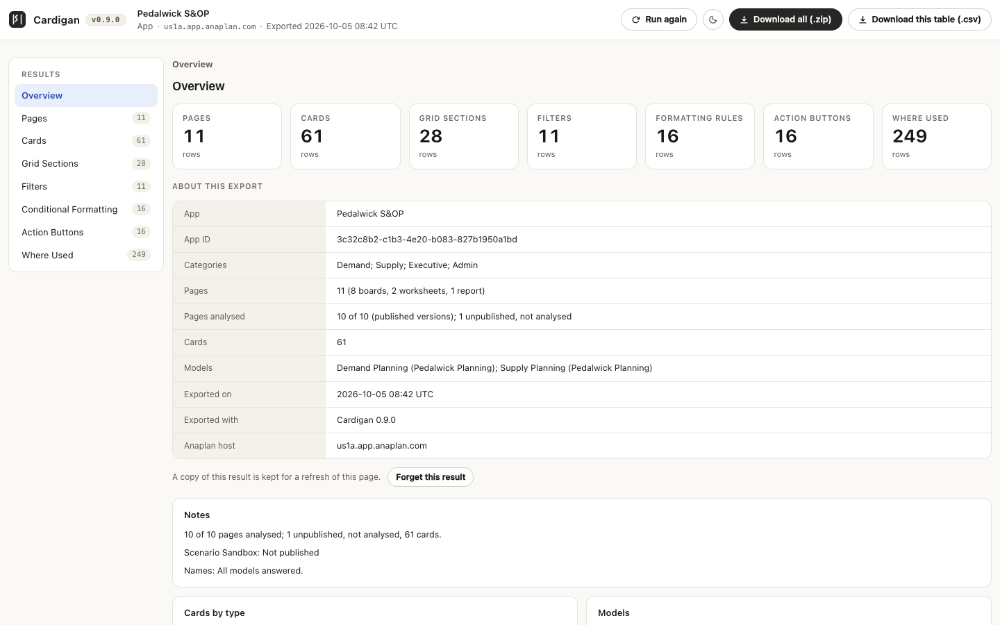
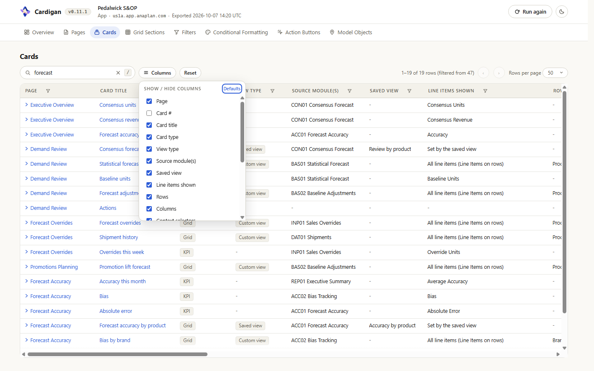
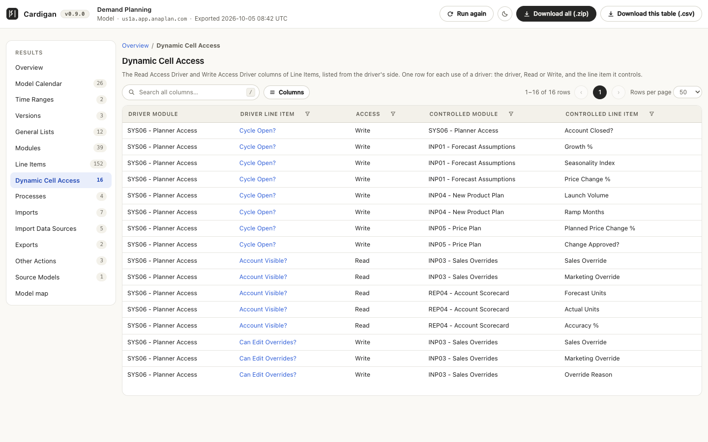
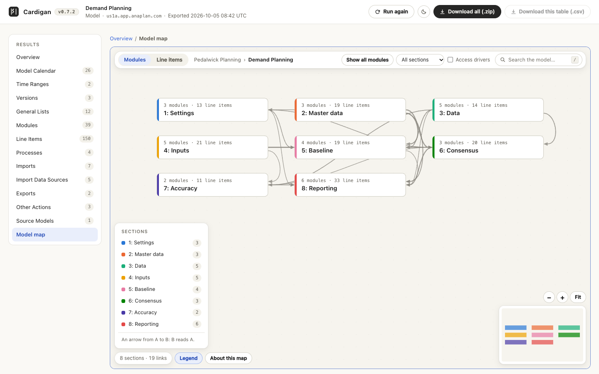

# Cardigan

Cardigan is a Chrome extension for Anaplan. Open an app or a model, click the Cardigan icon, and it reads what the app's pages or the model's settings hold. The result opens on a page of its own, where you can search, sort and filter each table. For a Classic model, the page also draws a map of what feeds what. Polaris models get a partial result for now.

Cardigan makes no file and offers no download: the results page is the only place to see a result. The last result is kept for its tab in the browser's session storage, so that a refresh brings it back, as you left it.

Cardigan only reads, with your own signed-in session, and nothing it reads leaves your browser. It is an independent project, not affiliated with Anaplan: see [NOTICE.md](NOTICE.md).

The pictures on this page show an invented app and model.

## What you get

### For an app

Cardigan reads every published page of the app. The **Overview** counts each table's rows, and under **About this export** says the **App**, its **App ID** and the **Models** its pages are built on. The tables:

| Table | One row per |
| --- | --- |
| **Pages** | Page: category, type, publish state, model and card counts |
| **Cards** | Card: type, modules, saved view, line items shown, rows, columns, context selectors, filters, formatting, buttons and text |
| **Grid Sections** | Section of a grid or chart; a combined grid has several |
| **Filters** | Filter condition on a grid's rows or columns |
| **Conditional Formatting** | Formatting rule or KPI indicator |
| **Action Buttons** | Button, with its action type and the model action it runs |
| **Model Objects** | Use of a module, line item, dimension, saved view, action or linked page by a card |

**Model Objects** opens **By object**: one row per object, with how many pages and cards use it and as what. A row opens the object with each of its uses. **Every use** lists the uses one by one.

### For a model

Open the model in Model Building; the classic model page opened on its own works too. Cardigan checks the model's engine first, with GET requests using the signed-in session. It reads the model's `engine` from the platform gateway (`hyperblock` means Classic; `calculation_engine` means Polaris), then tries the selected workspace's `dataEngineType` if needed. A Classic frame answering is the next fallback; an unknown engine continues with the Classic reader. The diagnostic log records the raw values and the chosen path.

**Polaris, for now:** **Modules** by name, with the dimensions the model data service supplies; **General Lists** by name and ID; and **Module Usage**, **Page Filters** and **Page Actions** from the published pages built on the model. Cardigan does not wait for a Classic frame. These are partial tables, not a Polaris settings read: dimensions that were not supplied stay empty, and list settings are not read. Only tiles and tabs with data are shown. The Overview says why **Line Items**, **Actions** and the **Model map** are absent. About this export keeps its usual rows: Workspace, Workspace ID, Model, Model ID and Apps.

**Classic:** Cardigan reads the Model settings into twelve tables, in Anaplan's order, and makes a thirteenth, DCA (Dynamic Cell Access), from Line Items: Model Calendar, Time Ranges, Versions, General Lists, Modules, Line Items, DCA, Processes, Imports, Data Sources, Exports, Other Actions and Source Models. The page calls two of them by shorter names than Anaplan's: **Data Sources** is Anaplan's Import Data Sources, and **DCA** is Dynamic Cell Access, which its tab and its tile say in full when hovered and to a screen reader.

It also reads the pages built on the model, in every app you can open, and makes three more tables: **Module Usage**, **Page Filters** and **Page Actions**. They come last, before the map. The pages are read while the Model settings are, since neither needs the other, and so are the names of the model's modules and lists; the rest of the names wait for the settings. The pages' cards are named with the line items Cardigan reads from Line Items, so a large model's pages are named without reading its modules again. The diagnostic log ends with a line that says how long the settings, the pages and the names took, and the run in all.

- A model's columns follow a reading order with Anaplan's names: what each row is, what it uses or does, then its run and notes where it has them. Hidden columns remain in the column chooser and the row's details. **Defaults** restores this layout; kept choices still apply. A missing column is skipped, and a new column follows the named ones and starts shown. Rows keep Anaplan's order and headings unless a table below says otherwise, with no sort mark or **Reset** at first.
- **Line Items** lists every row of Anaplan's Line Items grid, so it counts what the grid counts: each module's own row, in bold, above that module's line items, and each line item beside its module. **Format type**, after **Format**, gives each line item's data type: Number, Boolean, Date, Time Period, List, Text or No Data. It always has a filter: untick **(blank)** to list only line items, and **No Data** as well to leave out the line items that are headings. The table starts with **Name**, **Module Name**, **Format**, **Format type**, **Formula**, **Applies To**, **Time Scale**, **Versions**, **Summary**, **Referenced By**, **Cell Count**, **Calculation Effort**, **Page Filters** and **Notes**. The other known columns start hidden, including **Applies To from**, access drivers, **Ratio Numerator**, **Ratio Denominator** and **Format List**.
- **General Lists** starts with its name, hierarchy, top level and item count, then Numbered, Production Data, Properties, Subsets and Notes. Display Name Property and its three columns of references start hidden. **Modules** starts with its name, functional area, dimensions, time, versions, cell count and notes; Line Items and Referenced By start hidden. The chooser can add all of them back. **Time Ranges** starts with Name, Start Period and End Period; **Versions** with Name, Is Actual, Switchover, Edit From and Edit To. Their remaining columns stay shown. **Data Sources** shows the name, source type, model, object name and imports; **Source Models** shows the name, mapped workspace and model, Sources and Imports. Anaplan's header variants, such as **Top Level Item**, **Numbered List**, **Populated Cell Count**, **Type** and **Used in Imports**, keep their names.
- **A row's details keep the same order:** its name and table, the buttons for opening it elsewhere, then Mapping for an import, Actions for a process, or Sources and Imports for a source model. **All columns** follows in the table's order, with hidden columns after; a column with its own section is not repeated. Raw values such as **Format as read** sit last under **As read**, folded until opened.
- **The table stays usable beside the details.** Click another row to read it there. Following a row link inside the panel shows **Back**, which returns to the previous row; selecting a table row starts again. The header keeps its Timezone, Run again and theme buttons together above the panel. On a narrow window the panel may cover part of the table, with no scrim. **Esc** closes it and returns focus to the opening row.
- **A row's details list a cell of several items one to a line**, with how many beside the column's name, such as **Referenced By (10)**: what a module or a line item applies to and what refers to it, a module's line items, a list's subsets, properties and what uses it, an action's processes and a data source's imports. A module's line items are its rows of Line Items, so a name that holds a comma stays one item. A list of more than fifteen shows its first twelve, and **Show all** shows the rest in place; the browser's find in page finds them too. An item that is a row of the model, a module, a line item, a list, a process or an import, opens that row's details, where exactly one row has its name, including a cell with just one item. Module Name, Target Object, DCA's modules and line items, a page filter's condition line item and modules, a page action's model action and a data source's Source Model link to their rows too. An unmatched, ambiguous or Missing name stays plain text. A cell that names things without quotes, where Cardigan has no names to check them by, is shown whole: **Used in Dashboards**, **Data Tags** and **Users List**.
- **Open a row where it leads, from the buttons under its name in its details.** They stand side by side in one row, each with its icon, and wrap onto a second row only in a narrow window; the close button stays alone at the top right:
  - **Model map** shows a line item, a module or a list on the map, from **Line Items**, **Modules**, **Module Usage**, **General Lists**, **DCA** or **Page Filters**, where that box exists. DCA opens its driver, or the controlled line item where the driver has no box; Page Filters opens the condition line item.
  - **Model** opens the row's module or list in Model Building: a line item opens its module, since Model Building opens modules, not single line items, and a row of **General Lists** opens its list. In **Page Filters**, **Condition module** and **Filtered module** open the filter's two modules, or one **Model** button where they are the same, and **Filtered list** opens the list the filtered dimension is, or the list of a subset. Where the Anaplan tab shows the model in Model Building, the module or the list opens there beside the tabs already open, as Model Building's own Modules list and General Lists open one, and the page does not load again. Anywhere else, the object's own link is loaded, which opens the model with that module or list alone. As in Model Building itself, a list opens only for a workspace administrator; to anyone else Anaplan says that it cannot find it.
  - **App** and **Page** open the app and the page in Anaplan, from **Module Usage**, **Page Filters** and **Page Actions**.

  What **Model** opens, from each of a model's tables:

  | Table | Model opens |
  | --- | --- |
  | Modules, Line Items, Module Usage | the module |
  | DCA | the driver's module and the controlled module (**Driver module**, **Controlled module**), or one **Model** where they are one |
  | General Lists | the list |
  | Page Filters | the condition line item's module and the filtered module, and the filtered dimension's list (**Filtered list**) |
  | Model Calendar, Time Ranges | the Time page |
  | Versions | the Versions page |
  | Line Item Subsets | the Line Item Subsets page |
  | Processes, Imports, Exports, Other Actions, Data Sources, Page Actions | the Actions page |
  | Source Models | the Source Models page |

  A page of the model's settings opens the same way: where the Anaplan tab shows the model in Model Building, inside the page, as Model Building's own sidebar opens it, so the modules and lists open there stay open; anywhere else, by its Model Building address, which loads Model Building afresh. Either way it opens as a whole, since neither way says which row to select.

  A button's title names what it opens, and only the buttons whose place is known are there: what a row names **Missing** has no **Model** button, and a line under the details' header says the model doesn't have it. Modules and lists open in the Anaplan tab Cardigan read, which comes to the front with its window. Apps and pages open in a tab of their own: the first **App** or **Page** opens a new tab next to this page, and every later one uses that tab. No tab opens for each click, and the details stay open here. If the Anaplan tab has been closed, the first module or list opens one tab in its place, and every later one uses that; a closed tab of apps and pages is replaced the same way. A refresh of this page keeps both. Where the result keeps every row from a way to open it, as one an earlier version read, a line under the details' header says why. The Anaplan tab never goes to an app, so **Run again** reads the model again. A model tab that still holds the reader of an earlier Cardigan first gets this one's, where Chrome lets Cardigan reach the model's frame, and the module, the list or the page then opens beside the tabs already open; elsewhere it loads the object's link, which brings the new reader with the page.
- **DCA** (Dynamic Cell Access) lists each access driver with the line items it controls, one row per use, marked **Read** or **Write**. It is made from the **Read Access Driver** and **Write Access Driver** columns of Line Items, which name a driver only on the line item it controls.
- The page says a format, a summary or an action's definition in words, such as "Number, 2 decimal places", "List: Products" or "Delete from Products using Selection". Click the row and open **As read** to see the definition under **Format as read**, **Summary as read** or **Action as read**.
- **Processes**, **Exports** and **Other Actions** are the Actions list, split at its headings. **Processes** lists right after each process's name the actions it runs, in the order it runs them, with a filter by each action; it leaves out **Used in Processes**, as Anaplan runs no process inside another, and **Action**, where every process leaves it empty. After **Action** in **Other Actions** comes **Action List**, the list an action deletes from or orders, as General Lists names it. **Used in Processes** follows the action, then **Start Date and Time**, **Most recent duration (ms)** and **Notes**. **Used in Dashboards** starts hidden in all four action tables. **Imports** starts with **Name**, **Source Type**, **Source Label**, the source model, module and saved view, then the target type and object, processes, run, notes and **Production Data**.
- In **Imports**, an import from a module or a saved view shows its **Source Object** as three columns, **Source Model**, **Source Module** and **Saved View**. For an import from the model itself, Source Model names the model. Click the row and open **As read** to see **Source Object as read**. Any other source, such as a file, stays as it is, under Source Model.
- **An import from a file shows its mapping.** Click a row of **Imports** whose **Source Type** is FILE: before **All columns**, **Mapping** lists each source of the import first, with the target it feeds. The file's columns come first: each by the file's header for it where the import keeps one, as Anaplan most often saves a column, or else by its number ("Column 3"), in the file's order where the import gives the columns' places, and a column that feeds two targets has a row for each, together. After the columns come the constants with their values, the prompts and the header row. For an import into a module the targets are its dimensions (each list, **Time**, **Versions** and **Line Items**) and its line items; for an import into a list, the list's items, **Parent**, **Code** and its properties. A target that nothing feeds has no row, so the table has no empty source: a line under it names each such target after **Not mapped**, with why where there is more to say (ignored, or a list that numbers its items itself). Above the table of an import into a list, a line says how the list's items are told apart, in Anaplan's own words for the import's choice: **Items uniquely identified by** Name or code, Name only, Code only (for a numbered list, Name (#ID) or Code), or a combination of properties, each named. That is why **Parent** or **Code** may rightly be not mapped, and a numbered list told apart by code or by properties numbers its items itself, which the line of targets not mapped says. Of an import into a module, a line under a source says how it is read, where the import keeps it: how many of a dimension's items are mapped by hand and how many ignored, the format **Time**'s periods are read by (or that they are matched by their names), and a date line item's format. A dimension whose items nothing is mapped for by hand is matched on its items' names or codes when the import runs, and a line under the table says so. Where the line items come from the header row, each header mapped to a line item by hand is a row of its own, with its line item, and each header ignored a row that says **Ignored**, after the other columns. Where none is, the header row is matched on the line items' names or codes when the import runs: Anaplan stores no such match, as **How to read** explains. The mapping lists under the header row the line items of the module that a header can match (the first five, and **Show all** for the rest), which are the headers the file can use, not the file's own. With the header row the import has no single column of values, and the page names none as not mapped. Another line names the file's columns before the last one mapped that no target uses. Notes under **Mapping** describe only this import; **How to read** explains which headers Anaplan stores and why columns after the last mapped one are not known. The mapping comes from the import's own saved definition, so it shows even when the file is no longer available. An import into users, versions or line items says what it loads instead. The diagnostic log on the Overview follows each step: how many imports there are by **Source Type**, the read of their definitions, each definition's make (its keys), how it writes its first column (each of the three ways a definition can, by its type and at most 20 characters of its value), the keys of the parts that could say more of its columns, a line on how its items are matched (each dimension's items mapped by hand and ignored, with the type and length of the first two source values but never their text, the codes behind them, which items it clears first, and whether **Time** has a period format), and how many mappings were found and read.
- **A process lists the actions it runs.** Click a row of **Processes**: before **All columns**, **Actions** lists each action the process runs, numbered in the order it runs them, with its kind (Import, Export or Other action). Click an action's name to open its own row. The order comes from the process's own saved definition, as Anaplan's Actions tab reads it. For a result an earlier version kept, or where the definitions could not be read, **Actions** lists the actions whose **Used in Processes** names the process instead, by kind, and says that the order is not known. The diagnostic log says how many processes there are, and how many were read with how many actions of each kind.
- **Source Models** shows **Mapped To** as two columns, **Mapped Workspace** and **Mapped Model**: the workspace and the model each source model is mapped to, by name, or by ID where Anaplan gives no name. Click the row and open **As read** to see **Mapped To as read**. Above it, the row's details list what that source model gives: **Sources**, each of its objects that the model's imports read, with its kind (saved view, module or list), from the rows of **Data Sources** that name it; and **Imports**, each import that reads them, with what it reads. A name opens its own row where exactly one row has it. A source model is found by its name as each table writes it, or by the model's own name where one table puts its workspace in front and no other source model has that name. Where Data Sources names none of its objects, the imports come from the Imports table's **Source Object**. Where what is found is not what the row counts, a line says so; a source model that neither table names gets no list, and the diagnostic log says so.
- **Module Usage** lists each module with the apps and pages that use it, one row per module and page, in the order of Modules, then app and page. A page uses a module when a card on it shows the module, a saved view of it or one of its line items, or filters or formats by one of its line items. A module that no page uses has one row, with a dash, greyed, for its app and its page: a filter of either lists the dash as a value, and the search finds the module by its name. **App** always has a filter.
- **Page Filters** has the columns of an app's **Filters** table for those pages, with the app, in an order of its own: first what filters, the condition line item's module and the line item, then what it filters, the module, the dimension and the line items the grid shows (**Filtered line items**: all of them, only some or all but some, by name), then the condition (operator, value, which items show, its group and context, and what it filters on), and then where it is: app, page, card and section. **Page Actions** has those of **Action Buttons**: first the model's action a button runs, by name and type, then where the button is, by app, page, card and label, then how it behaves. Both list every filter and every button of a card that works on this model. Page Filters rows are sorted by the condition line item's module, then the line item, app, page and card. Page Actions rows are sorted by Model action name, then app and page.
- The three tables end with columns that start hidden: each page's type and the IDs of its app and of itself, beside the IDs the app's tables hide. Card and section numbers also start hidden, as does **Name source** in Page Actions. The column chooser shows them.
- **Missing** marks what a card on a page points at that the model doesn't have: deleted since the page was built, or hidden from you. The cell says what it was and keeps its ID, such as **Missing module (ID 102000000556)**, **Missing line item (ID 1916000000014)** or **Missing process (ID 118000000003)**, so searching for the ID finds the row; the hidden ID columns hold the ID too, and a missing filter line item's is now in **Line item ID**, where a dash stood. Where a filter's condition line item is missing, its module reads **Missing line item: module not known**, since nothing says which module it was in; the module may still be in the model. A line under the table's name counts the filters, buttons or pages that point at such things, with what they point at, such as "1 filter points at a module and a line item this model doesn't have", and the Overview's notes say how many cards do. In the row's details there is no **Model** button for what is missing, and a line under the header says why; **App** and **Page** open the page, to fix the card. Only what the model's names prove is marked: a module the model's list of modules doesn't hold, a line item that its module's line items don't list, a filter rule's line item where the rule has one item that nothing names and every module's line items were read, and an import, export or process that the model's actions don't list. A dimension or a list that nothing names keeps its ID, as does a filter rule with two items that nothing names, either of which may be its line item.
- **Line Items** has one more column, **Page Filters**: how many page filters have the line item as their condition. It is empty rather than 0 when a page could not be read, or a filter's condition line item could not be named. A filter whose condition line item the model doesn't have counts for none of them, and leaves no count empty.
- On the Overview, **About this export** says the **Workspace** and its **Workspace ID**, the **Model** and its **Model ID**, and **Apps**: the apps whose pages use the model, one per line, or that no app's pages use it. It says nothing more: the Anaplan host the model was read on and the version that read it are the first line of the diagnostic log.
- Under **About this export**, the model's name opens the model in Model Building, in the Anaplan tab Cardigan read. Where that tab shows the model in Model Building already, it only comes to the front, with what is open there; anywhere else it loads the model's address, the one Model Building's own model menu links to. Each app under **Apps** opens that app in the tab of apps and pages, the same tab the **App** buttons use. An app is a link only where Cardigan knows its ID, from the rows of **Module Usage**, **Page Filters** and **Page Actions**, and where that name goes with one app alone; any other name is plain. The names are links only where the result says where the model is, as one read in Model Building does. Like the buttons in a row's details, a link's title says what it opens.
- **Model Calendar** lists the calendar's settings that hold a value: a setting that does not apply to the model's calendar type, or that the model does not show, is left out, and so are the template's **Applies to** and **Notes** columns, which only guide filling it in by hand. Its **Section** column, which says the same of every setting listed, and its **Allowed values** column start hidden; the column chooser shows them, and a row's details list them. The template's rows about the model itself are not listed either: the Overview names the workspace and the model, under **About this export**.

#### Model map

**Model map**, the last entry in a model's navigation, draws the model: its groups, modules and line items, and what feeds what. It is made from the tables above and nothing else, so it reads nothing more from Anaplan.

- The bar across the top of the map has three parts, each on one line; on a narrow map each part takes a line of its own.
  - **Where the map is.** One path always has three steps: the model, group and module. Each name shows in full; the pills grow to fit it. Where the bar runs out of room, the path takes its own line before its steps or names wrap. A name goes to that place; the drawn chevron beside the group or module opens its list. The group list offers **All groups**, **All modules**, then every group with its module count. Every choice moves the map. The module picker lists every module under group headings, in the map's group order, with no count limit. It scrolls to the current module's group and marks the module. Typing finds names across every group and keeps the headings with matches. The group step always names the displayed module's own group, and never narrows the picker. The workspace is under **About this export** on the Overview; the model's name also says it on hover.
  - **How the map is built.** **Group by** stays in the bar at every level. Changing it inside a module keeps that module, the selection and the drawing; the path and the picker's headings follow the new grouping. Under **Links**, **Other modules' line items** appears while a module is shown: tick it to show those line items one by one, or leave it unticked for one box per other module.
  - **Its tools.** **Links** opens a panel of the links the map draws: **Formulas**, ticked as the map opens, and **Access drivers** and **Page filters**, each where you tick it. Untick **Formulas** to see only access drivers and page filters: the formulas' arrows go, every box stays where it was, and a trace follows only the arrows still drawn. With none of the three ticked, no link is drawn, and the line at the foot of the map and the legend say so. The legend says what each kind of link drawn means, and only those. The **Links** button keeps the same width with or without its dot. It has the dot whenever the links drawn are not formulas alone, and what you tick is kept for the tab with the rest of the map's place. Read and Write Access Drivers are line items that decide which cells of a module or line item someone can see or edit (Anaplan's dynamic cell access); ticked, the map draws an arrow from each driver to what it controls. Page filters are Boolean line items used as filters on the pages built on the model, as **Page Filters** lists them, with the line items each filter's grid shows. Ticked, the **Line items** view draws an arrow from each filter line item to each line item it filters, in plum dashes, once however many cards it filters there. A module's own filter, such as its Incomplete Records filtering its rows, runs among that module's line items; a filter on another module's grid runs to that module's box, and in the filtered module the filter's module points at each line item it filters. A filter line item that its grid shows as well has a plum mark with a funnel instead of an arrow to itself, as has one whose grid does not say which line items it shows. At every level, formula links alone place the boxes. Ticking or unticking any link kind keeps every box and the camera where they were, including boxes dragged by hand. Access drivers and page filters are drawn over that layout. A box brought in only by an unticked kind stays in place, dimmed. If the legend grows, it lies over the map. Between modules, the map draws one arrow for each filter line item and each other module whose grid it filters, and marks a module that its own line items filter with a plum mark on its top edge, holding a funnel and how many of its own line items filter it. A group's mark says how many of its modules are filtered so. Zoomed out, where a box is too small for the mark, it is a plum dot at the box's top right. While page filters are drawn, a line item's hover card says where it filters, and what filters it. The legend says what the dashes and the mark mean while they are drawn. The note under the box says what ticking it draws: arrows, marks or both. A result read before Cardigan said which line items a filter filters draws each filter to the modules it filters, and its note says to run the model again. Where there is nothing to draw, the box is off, and its note says why: the result has no **Page Filters** table; the pages have no filters; none of the table's filters has a line item of the map as its condition, with how many filters there are; or none of them filters a module of the map. When the map is first built, the diagnostic log says how the table met the map: how many rows, how many have their condition line item on the map, how many of those filter its own module and how many another, how many say which line items they filter and how many of those line items the map does not have, and which condition line items the map does not have, by module and name. A line item is found by its module's name and its own as written, or, where Line Items and **Page Filters** write them differently, without the spaces at their ends or with a run of spaces as one, where one line item alone fits. A link of either kind is followed by a trace only while it is drawn, and no formula counts it; a mark is followed by none, and neither changes a module's role in the data flow. Then the search, and **Full screen**.
- The map groups the modules into groups, and opens on them. **Group by** chooses how, and marks the map's own pick as automatic:
  - **Functional area**: each module's Functional Area, from Modules, where the module is found by its name. The areas come in the order of their names, numbers as numbers, as Anaplan lists them, and the modules with none last, under **No functional area**. When the map is first built, the diagnostic log says how many areas the modules have, how many modules have one, and which rows of Modules are no module of the map and which modules of the map have no row in Modules, so a module under the wrong area can be told from one the export gave none.
  - **Headings**: the modules under one heading, a module whose name starts with `--`, such as `-- Inputs --`.
  - **Name prefix**: the code a module's name starts with, such as INP for `INP01 Volumes`, where enough modules share it: three, and at least one in fifty. The rest are under **Other**. The codes are learnt from the model's own names; none is built in.
  - **Role in the data flow**: Data, Input, System, Calculation or Output, worked out from what the model does with each module, never from its name. An import loads into a Data module, which is mostly without formulas. An Input module is mostly without formulas. A System module applies to no list, and three or more other modules read it. A Calculation module is mostly formulas that another module reads. An Output module's formulas no other module reads, or an export takes it.
  - **App**: the app whose pages show the module, from Module Usage, or **Several apps**, or **Not on any page**.
  - **Main dimension**: the first list the module applies to, a subset as its list, or **Time only**, or **No dimensions**.
- The map's own pick follows the model's builders first. It opens on the functional areas where three in five modules or more have one, in two areas or more, however many areas there are; and else on the heading rows where three in five modules or more stand under one. Otherwise it opens on the name prefixes where they group the model well: from 3 to 15 groups, none with more than half the modules, and at most a fifth of them left over. Otherwise it is the role in the data flow. A choice of yours is kept in this browser for the next map. A grouping that makes one group shows the modules instead.
- A module's details say its group and where it comes from, such as "INP · from module names", and for a role, why. The search says the group and where it comes from too. The ninth to the sixteenth group have the first eight colours again, in stripes.
- Select a group or module, then use **Show its N modules** or **Show its N line items** in the details to go down a level. A double-click does the same, as **About this map** explains. `Esc` goes from a module to its own group, then from a group to the model, regardless of the last view visited. Open lists close first. The map's place, link choices and selected box stay kept for the browser tab, including views kept by older versions. A refresh or **Run again** reopens the selected box's details where its name and module or parent still match one box. Changed formulas, counts and object numbers do not lose it; a missing or ambiguous name clears the selection.
- An arrow from A to B means B reads A.
- Click a box to see everything that feeds it, marked in blue, and everything it feeds, marked in red, directly or through others. The rest fades; **Only these**, under the details' buttons, hides it. Dashes move along the marked links for as long as the box is selected, long ones towards it and short ones away from it; they stand still if your system is set to reduce motion. Opening or closing the details moves neither the boxes nor the camera. Closing them clears the selection. A box you go to by the search, a link in the details or the arrow keys is brought into view beside the details, with what it has links with where they fit.
- The details start with the box's full name and its kind, then one row of buttons: **Show its N line items** for a module or **Show its N modules** for a group, **Table** and **Model**. **Table** shows the matching row in Line Items, Modules or General Lists with its details open, bringing it onto the table's page and clearing a search or filters that hide it. **Model** opens the module or list in Model Building as the tables do; a line item opens its module, using the IDs the run already read. Only buttons with somewhere to go appear. The trace's counts follow the buttons, with **Only these**. Raw format and summary values sit last under **As read**, folded until opened.
- The panel on the right gives the box's details: for a line item its formula, format and summary in words, and what feeds it and what it feeds directly. A line item's details also list the page filters that have it as their condition, from **Page Filters**: what each filters, by app, page and card, and by which dimension, the first ten and how many more, and under **Modules it filters on pages** each of those modules, which a click goes to, and under **Line items it filters on pages** the line items their grids show. A line item's details list under **Filtered on pages by** the filter line items whose grids show it, and a module's the line items whose filters filter it, its own among them, each with where. These lists are there whether page filters are drawn or not.
- The line at the foot always shows, and **Legend** and **About this map** keep their places with or without a selection. The trace appears once, inside the details. The box's full name wraps even on a narrow map.
- The search finds groups, modules and line items by name. In the **Legend**, click an entry to hide or show its boxes.
- From **Line Items**, **Modules**, **Module Usage** or **General Lists**, **Model map**, among the buttons under a row's name in its details, goes straight to that line item, module or list on the map, selected, with what feeds it and what it feeds. The table's details stay kept while the map is shown. **Table** returns to the row with its details open, and **Model map** selects the same box again. A list is shown beside the line items of the first module it is linked with; a list linked with no line item is on no map.
- **Full screen**, at the end of the bar, gives the map the whole screen, with its bar, details and legend. The button and `Esc` leave it. Where the browser will not give it the screen, the map fills the browser's window instead, and `Esc` leaves that too.
- Drag to move, scroll to zoom, press `F` for the whole map. A click may shake a little and still be a click, a little more with a finger than with a mouse. **About this map** lists the keys. The map follows the page's theme.

## Install

Cardigan needs Chrome 111 or later, on Windows or on a Mac. Nothing else has to be installed.

1. **Download the extension.** On the [latest release](https://github.com/larasrinath/cardigan/releases/latest), under **Assets**, take `cardigan-<version>.zip`: the entry that shows a file size. Do not take **Source code (zip)** or **Source code (tar.gz)**. GitHub adds those two to every release, the zip one even arrives under the same file name, and they hold the source code, which Chrome cannot load.
2. **Unzip it into a folder you keep.** Chrome loads the extension from that folder every time it starts. On Windows, right-click the zip and choose **Extract All...**; on a Mac, double-click it.
3. **Look into the folder.** It must hold `manifest.json` and a `dist` folder with four `.js` files. If it holds `src` and `package.json` instead, it is the source code: go back to step 1.
4. **Load it in Chrome.** Open `chrome://extensions`, turn on **Developer mode** at the top right, choose **Load unpacked** and select that folder.
5. **Click the Cardigan icon on an Anaplan tab.** An app that was open before needs no refresh: the click puts Cardigan's script there. Neither does a model in Model Building that was open before: where the click cannot reach the model's frame, the results page offers **Refresh the Anaplan tab and run**. The puzzle icon in Chrome's toolbar lets you pin Cardigan there.

If Chrome says **Could not load javascript 'dist/content.js' for script** and **Could not load manifest**, the folder you selected has no `dist` folder: it is the source code, or a folder above or below the right one. Start again from step 1.

To check the download, compare it with the SHA-256 published with the release: `shasum -a 256 cardigan-<version>.zip` on a Mac, `certutil -hashfile cardigan-<version>.zip SHA256` on Windows.

To update, unzip the new release over the same folder and click the reload icon on Cardigan's card in `chrome://extensions`. An app's tab needs no refresh: click the Cardigan icon on it. A model's tab needs nothing either, in most cases. The part of Cardigan that reads a model runs inside the model's page, which keeps the earlier one until it is refreshed:

- An update that leaves that part as it was keeps it as it was: its mark comes from its code, not from the version, so the tab reads on.
- One that changes it: the results page puts the new reader into the model's page itself, as Chrome does when the page loads, and reads the model. Chrome lets it do so where the model is served from the tab's own Anaplan host.
- Where the model is served from another Anaplan host, Chrome lets Cardigan put nothing there. The results page says so and offers **Refresh the Anaplan tab and run**: the tab reloads, which closes the modules and lists open in Model Building, and Cardigan reads the model as soon as it shows. Nothing refreshes the tab unless you choose that.

To see which version you have, right-click Cardigan's icon in Chrome's toolbar: its menu says the version, greyed out, under **About Cardigan**, and the icon's title says it when the pointer rests on it. **About Cardigan** opens a page with the version, what Cardigan is, and links to what's new, privacy, help and the source. The first line of the diagnostic log says it too, and [CHANGELOG.md](CHANGELOG.md) says what each version brought.

## Use

1. Sign in to Anaplan. Open an app, or open a model in Model Building and wait until it has loaded.
2. Click the Cardigan icon in Chrome's toolbar. If that Anaplan tab already has an open results page, Cardigan brings its tab and window forward and runs again there, keeping the table or map and the open row where it still exists. If it is already reading, it carries on. With no answering results page after about 300 milliseconds, a new one opens in the next tab and starts reading.
3. Keep the Anaplan tab open until it finishes. The page shows each step, then the result. Diagnostics starts folded; a failed run opens it, and **Copy diagnostic log** works in either state.

Closing the results page stops the reading.

### The results page

- The page stands in a column in the middle of the window, at most 1,400 pixels wide, with room at both sides that grows with the screen. A table wider than the column scrolls sideways in its own box. The model map takes the whole width of the window.
- The header says the name of the app or model the result is of, and holds **Timezone**, **Run again** and the theme's button. A name too long for the header ends in an ellipsis, and its title holds it whole. What was read is under **About this export** on the Overview, and the Anaplan host it was read on is the first line of the diagnostic log.
- The navigation is a bar under the header, with an icon for each entry: the overview, each table and a model's map. A model's tables are grouped in menus, **Time**, **Lists**, **Modules** and **Actions**, with **Versions**, **Source Models**, **Module Usage**, **Page Filters** and **Page Actions** on their own; a group with only one table in the result is that table's entry. A menu's button names the table shown when it is one of the menu's, and is marked; the menu marks that table too. Every entry and menu keeps its own place, so choosing a table or another view moves nothing else in the bar. Where the tabs fit on one line, they spread evenly across the bar, from one side of the page's column to the other, with equal gaps between them; the tab of the view shown, in bold, and a menu's button naming the table shown, which can be longer than the menu's name, grow into the gaps beside them. Where the bar is too narrow for that, a menu keeps the extra room its longest table's name needs beside its own name, and where the tabs don't fit at all, they wrap onto a second line, packed at its left. A model's bar with every table fits on one line in a window about 1,280 pixels wide or wider, with all its gaps equal from about 1,480 pixels; in a window narrower than 1,000 pixels, one menu holds every entry. The Overview's tiles are all the same size, taller than their lines need. Each shows its table's icon, as the navigation has it, and the table's name at its top left, and at its bottom right, in large figures, the number of rows the table lists, nothing more; a name too long for its tile ends in an ellipsis, and the tile's title holds it whole. A count of five figures or more is drawn smaller in a narrow tile, so that it is never cut. A model's **Model Calendar** tile says what the calendar is instead of a count: **Monthly** or **Weekly** in the number's place, at the right, and under it, small, how a weeks calendar is grouped (4-4-5, 4-5-4 or 5-4-4, 13 periods, or its number of weeks) and the current fiscal year, such as **FY24**; its title holds the calendar type as Anaplan writes it and the year's dates. A calendar whose type and year were not read is counted like any other table. A click on a tile opens its table. Where a table leaves rows of its file out, as Model Calendar does, the line under the table's name says how many and why. Under the tiles, **Tables** lists only what they cannot say, such as a table that was not exported, with the reason; with nothing to list, it is not shown. Where some of a model's imports could not be matched between Anaplan's Imports tab and its Actions list, a note says how many, and that some of their columns are empty; where every one was, the tile's count says it all.
- A table's name and its toolbar share one row: the search box, with the column chooser at its right end, then **Reset** once a search, a filter, a sort or a page's cards are in force, and at the row's right end the count of rows and the pager, which always stay together. In a window too narrow for one row, the name takes a line of its own first; the count and the pager go under the search box only after that. The search box looks in every column, shown or hidden. Press `/` to reach it: the box's tooltip says so, and no key is drawn in it, nor in the model map's search box.
- Click a column's name to sort: a small chevron beside the name points up while the column runs from its least, and down while it runs from its most. Almost every column also has a filter, the funnel beside its name:
  - Any column with 2 to 30 different values has one.
  - A model's tables offer filters on every column except **Name**, **Formula**, **Notes** and IDs, with ranges for numbers and dates.
  - In an app's tables, a column with more has one too, unless it holds what nobody picks from a list. That means a row's own name in a model's tables, free text (**Formula**, **Notes**, a card's **Text content**) and IDs. It also leaves out a column whose every value is in one row only, such as **Code**. The search finds a value in those.
  - A filter with more than 15 values has a box to find them: the list shows what it finds, and **Tick matches** and **Untick matches** tick or untick all of that, listed or not. At most 300 values are listed at once; type to narrow the list.
  - A column of numbers or of dates is filtered by a range instead of a list to tick: **From** and **To**. That is any column whose every value is a number, or every value a date: counts such as **Cell Count** and **Item Count**, the **Sources** and **Imports** of **Source Models**, an action's duration and start, when a page was last published, a card's number. Either box may stay empty, for no end on that side, and both ends are kept: from 3 to 3 keeps card 3. A box for numbers shows the column's lowest or highest value until you type, and takes 1200, 1,200, -3.5 or 40%. A box for dates is the browser's own, and keeps whole days: until 12 March keeps an action that started late on 12 March. For a column of times the filter says which zone they are in, and its days are days of the zone they were set in (see **Timezone**, below). Under the boxes, **Keep blank cells** keeps or leaves out the rows with nothing in that column. **Enter** or **Apply** sets the range, and a box Cardigan cannot read says what is wrong instead. The funnel says what the range keeps, such as "≥ 10" or "10–100"; **Clear** and **Reset** take it away. A code made of figures that begin with a zero, such as 0040, is no number, and an ID is never filtered by a range.
  - The columns keep their widths whatever the sort, the page, the search or the filter.
- Counts, such as **Cell Count** and **Item Count**, show their thousands with commas, and so do the edges of their range filter. A formatting rule's **Colour stops** say each colour and the value it stands at, such as "#F5A5B1 at -10; #627786 at 100,000", with a square of each colour before its code.
- The column chooser, the button with three lines at the right end of the search box, picks the columns shown. An app's ID columns, **Card #** and **Section #** start hidden.
- Click a row to read every value in full. In an app, a page's name shows that page's cards: a chip beside the search box names the page, and its cross shows all the cards again. A card's title opens the card with its grid sections, filters, formatting and buttons.
- Where a value lists several items, such as a line item's **Applies To** and **Referenced By** or a card's **Context selectors**, the panel that opens lists them one per line. The table keeps them on one line, and the search and the sort read them as the table shows them. The filter lists each item on its own, with the rows that list it, and shows a row when any of its items is ticked: untick every region but one under a module's **Applies To**, and the modules that apply to that region stay. A name in quotes stays whole, commas and all.
- Click an ID to copy it.
- The sun or moon button switches the theme.
- **Timezone**, in the header, is one pill with a globe: it says the zone the page's times are in, **Local**, your own time zone, or **UTC**, as Anaplan writes them, and a click switches to the other. It is Local unless you chose UTC, which every results page then keeps. That is when each action of a model's Processes, Imports, Exports and Other Actions last started, under a header that names your time zone in the place of "(UTC)", such as "Start Date and Time (Europe/London)". A row's details say its time in both, the one shown first: "2026-03-13 08:19:56 local · 2026-03-12 23:19:56 UTC". The search finds a time as it is shown, and the sort goes by the moment. A range of days keeps the days of the zone it was set in, and so the same rows when you switch: its funnel then says whose days they are. A date without a time, such as when a page was last published, is the same in either.

**How to read these tables**, on the Overview, has the notes for reading them. One to know: "(not in the model)" after an ID marks a module or line item that a card points at and the model no longer has, or that you cannot see. A model's tables of the pages built on it say **Missing** instead, with the ID, such as **Missing module (ID 102000000556)**.

### Run again, refresh and Forget this result

- **Run again** reads the Anaplan tab again, keeping the table or map you are on. The result stays until the new one is complete. The button keeps its width and says **Reading** beside a small spinner; its title and the screen reader's live region say the progress. No progress banner moves the content. A failure still shows the existing card.
- A row's details reopen after **Run again** on the same app or model, found by its table, name and module, or its list or parent where it has no module. An edited formula, format, count or note does not lose it. A row that is gone, renamed or no longer unique stays closed. The header's **Run again** stays usable while the details are open. A first run from the icon opens on the Overview.
- The last finished result is kept for its tab, so a refresh brings it back without reading Anaplan, on the table or the map that was shown. A line above it says when it was analysed.
- Each table keeps its own search when you switch away and come back. A refresh keeps how you left the result too, until the tab is closed: every table's search, filters and ranges, the columns you showed or hid, its sort and its page; the rows a page lists; how **Where Used** is listed; where the model map was, its group or module, its links and selected box; and a row's details that were open. **Run again** on the same app or model keeps what still fits its tables, each column by its name; another app or model starts clean. **Reset** clears a table's. Settings kept by earlier versions still load.
- **Forget this result**, on the Overview, removes the kept copy at once, and how you left it. The result stays on the page until you refresh or close it.
- **Diagnostics** starts closed on the Overview too. Open it to read or copy the finished result's log.
- Only the icon starts a reading unasked. A results page that is reloaded, duplicated or reopened waits for **Run** or **Run again**.

### If it does not start

- **Waiting for the model to open…**: the tab is loading, or Model Building is there and the Classic frame has not answered yet. Cardigan waits for up to about two minutes and starts when it answers. If it still has not opened, the card says **Model still opening**; wait until it shows in Anaplan, then choose **Run again**.
- **Refresh the Anaplan tab**: Cardigan's reader is missing or belongs to an earlier version. Cardigan first tries putting its reader into the open tab. Where Chrome refuses, or the reader cannot reach the model, choose **Refresh the Anaplan tab and run**. This closes the modules and lists open in Model Building; nothing refreshes the tab unless you choose it.
- **Not an Anaplan tab** or **Tab closed**: the page says what the tab shows, or that it was closed. Open the app or model in Anaplan, then click the icon on that tab.
- **No model open**: the tab shows an Anaplan page that is neither an app nor a model. Open a model in Model Building, then choose **Run again**.
- **Anaplan is down for maintenance**: an Anaplan request returned HTTP 503, or an HTML page's title or heading announces maintenance. The card says **Try again when it's back. Nothing was read.** Choose **Run again** when Anaplan is back. Other HTTP errors and ordinary error pages are not called maintenance.
- When a reading stops, a compact card gives the reason and a main button to try again or refresh, with **Copy diagnostic log** beside it. The log's last line identifies a connection case as `MODEL_OPENING`, `NO_READER`, `OLD_READER`, `NOT_MODEL_PAGE` or `MAINTENANCE`. It also holds request paths, statuses, counts and how long each step took, and the names of a few modules and line items the map could not match, and no cookies, tokens or cell values.
- If the model map cannot be drawn, the page says so in the map's place. The tables are not affected, and **Copy diagnostic log** beside the message copies the reason.

## Privacy and permissions

- Cardigan declares three permissions, **activeTab**, **contextMenus** and **scripting**, and none comes with a warning. activeTab and scripting together let a click on its icon put its script back into that one Anaplan tab when Chrome has not, as in a tab that was open before Cardigan was installed, updated or reloaded, and the part that reads a model as well, in the frames of that tab's own Anaplan host. contextMenus adds two items to the menu of Cardigan's own icon, and nowhere else: **About Cardigan**, which opens Cardigan's About page in a new tab, and the version, greyed out. It asks for no access to any site. Its scripts run only on `https://*.app.anaplan.com` and, for Australia, `https://*.app2.anaplan.com`, and add nothing to those pages.
- It reads nothing until you click its icon or choose **Run again**. It is read-only by construction: its web requests are GET requests to two Anaplan services, its socket client can only subscribe, and every request to a model is checked to carry no change.
- A model's settings are read through the model's own page, and so are each import's saved mapping, as Anaplan's own import dialog reads it, and each process's saved list of actions, as Anaplan's Actions tab reads it. Beside them, Cardigan reads the pages built on the model as it reads an app's: GET requests for Model Building's list of those pages, each page, each of their apps and the model's action names, and the model data socket for the other names the pages' cards use. The line items it reads from the model's settings name most of those: the socket is asked for the line items of one module, to compare the two, and of a module they do not cover. It is asked for no saved view's rows, columns and context selectors, which only an app's tables show. The socket goes to the Anaplan host the model's own page is served from, its data centre, where Anaplan would otherwise send it.
- Nothing is sent anywhere except those reads, and the results page and the About page load nothing from the internet. The About page's links lead to this project's pages on GitHub, and open only when you click them.
- The buttons in a row's details, and the model's name under **About this export**, take your Anaplan tab to a module, a list or the model in Model Building; if that tab has been closed, the first opens one tab in its place. To open the model, Cardigan first asks its script in that tab what the tab shows, which reads nothing from Anaplan. Apps and pages open in one more tab, which the first **App** or **Page** opens next to the results page and every later one reuses. That changes which page a tab shows, and nothing in the model or the app. Where the Anaplan tab shows the model in Model Building, a module or a list is opened inside that page through the classic Model Building client's own way of opening one, the one its Modules list and General Lists use: Cardigan sends Anaplan nothing for it.
- The kept result is in the browser's session storage for its tab, compressed and not encrypted. So is how you left it, beside it: the values you filtered on and the search you typed can be names from your app or model.
- The theme you chose, how you chose to group the map's modules, and whether you chose UTC for the page's times are kept in the browser's local storage: a word each, nothing of your app or model.

[NOTICE.md](NOTICE.md) says the rest, including what closing a tab does and does not erase.

## Limits

- Only the published version of a page is read. A page never published is listed as "Not published".
- A page that is no board, worksheet or report has no **Page** button in a row's details: its app's opens all the same.
- Reading an app's names, or those of the pages built on a model, can make Anaplan load the model, as opening one of its pages would.
- **Module Usage**, **Page Filters** and **Page Actions** need the model open in Model Building at an address that names its customer (`/a/modeling/customers/…`), as Model Building's own links do: the pages built on a model are listed for its customer. Elsewhere, as on the classic model page opened on its own, the Overview lists them under **Tables** as "Not exported", with the reason, and so it does when Anaplan refuses the list of pages.
- They hold only the published pages you can open. A page that cannot be read is named in a note: a module on it may show a dash for its page, and a line item's **Page Filters** count is empty rather than 0. So is the count where a filter's condition line item could not be named: the filter keeps the line item's ID. Where the model's names prove that the model doesn't have that line item, the filter says **Missing line item** instead, and no count is left empty for it.
- **Missing** is said only of modules, line items and a model's imports, exports and processes. A dimension or a list that a card points at and that no read names keeps its ID: nothing Cardigan reads says that the model doesn't have it.
- They count a card for the model it works on: the page's, unless the card names another, which leaves it out. A button names no model of its own, so its card's decides.
- A saved view's own filters, sorts and hidden items are set in the model and are not listed.
- A card's shown or hidden items are named up to five per dimension, then counted. A text card's text is cut at 500 characters.
- A filter rule's line item in a module that no card shows is looked for during at most 45 seconds per model. After that the rule keeps its IDs, and a note says so.
- The items a filter rule names are looked up for at most 30 seconds per model. The rest keep their IDs.
- A button whose import, export or process is not in the model keeps its card label; **Name source** says so. In a model's **Page Actions**, **Model action name** says **Missing** with its kind and ID, such as **Missing process (ID 118000000003)**.
- Where two pages share a name, a count in **Model Objects** can read "2+" (at least 2), and some links are plain text.
- A Model settings grid of more than 250,000 rows is not read. The Overview lists it under **Tables** as "Not exported", with the reason.
- An import's **Mapping** knows the file only as the import's definition does: Anaplan keeps the mapping, not the file's header row. So it cannot say whether the file has columns after the last one mapped, and a column that the import names by its heading alone has no number: the columns before it that no number takes may be used, and the page says so. Where no column mapped has a number, the page says that it cannot tell which columns are not used. A header that the import matches on a line item's name or code when it runs is stored nowhere, so the columns matched that way are not listed: the line items under the header row are only those a header can match. An import from a module, a saved view or another model has no **Mapping**, and neither has a result that an earlier version kept: choose **Run again**.
- In **DCA**, a driver that cannot be matched to a line item is listed last, as Line Items has it and with no **Driver Module**, and the page says how many there are. The table is not made when Line Items was not read.
- The model map takes each link from a column that names another object, such as **Referenced By**. It shows formulas as text and does not work them out.
- The map draws sections, modules, line items and the lists that formulas name. Processes and actions are not drawn; a module's details name the imports that load into it.
- **About this map**, at the foot of the map, says what the map leaves out and could not place for this model, such as a line item named twice in one module.
- A large view is shown whole with names cut short: point at a box to read its name. One too large even for that opens on its start, and **Whole map** shows all of it.
- The map stays up during **Run again** and is rebuilt in place on the same view, group or module and links when the new result arrives. A refresh keeps these too, along with the selected box and its details, by name where it still exists. Zoom and position, search and full screen may reset. **Forget this result** starts it afresh.
- A result over 64 MB as JSON, or 9 MB compressed, is not kept for a refresh; the page says so.
- Anaplan can change the internal services Cardigan reads without notice: see [NOTICE.md](NOTICE.md).

## For developers

You need Node 20.19+, 22.12+ or 24+.

| Command | What it does |
| --- | --- |
| `npm ci` | Installs the pinned TypeScript, Vitest and esbuild |
| `npm run build` | Type-checks, then writes the five bundles in `dist/` |
| `npm test` | Runs the unit tests in `src/` (Vitest). `npm run test:scripts` runs those of `scripts/` |
| `npm run check` | Type-check, both test suites and the build. GitHub Actions runs it on every push and pull request |
| `npm run package` | Builds, then writes the release zip |
| `npm run icons` | Makes the four icons in `icons/` again from the logo, `icons/source.png` |

To run from source, choose **Load unpacked** and select the repository root. After a rebuild, reload the extension, then click the icon on the Anaplan tab: that puts the new content script there. What reads a model inside the page (`src/model-content.ts`, `src/model/`, `src/bridge.ts`) is loaded with the page. The build marks that reader with a hash of its code (`scripts/reader-mark.mjs`: its bundle, with the version and the mark as placeholders), which the first line of each bundle names, so a new version that leaves the reader's code as it was keeps its mark. The content script reads a model only with a reader of its own mark: the results page puts the new one into the tab where Chrome lets it (`renewReader` in `src/results/connection.ts`), and otherwise offers the refresh. `dist/` is not in Git: build after every pull.

In the Anaplan tab, `src/content.ts` and `src/analyse.ts` read an app, and `src/model-content.ts` and `src/model/` read a model through the page's own client. `src/model-pages.ts` then reads the pages built on the model, as an app's pages are read. `src/card-reader/` reads a page's cards. `src/background.ts` opens the results page: `results.html`, `results.css` and `src/results/`. `src/map/` builds a model's map from the model's tables and draws it on the page, styled by `map.css`. `src/protocol.ts` lists the messages between the page and the tab, and `src/results/connection.ts` connects the two, putting the content script back into a tab that has none, and the model's reader into one whose reader is of another build.

### Release

Every merged change that alters the extension takes the next version, as the top of [CHANGELOG.md](CHANGELOG.md) says: the next minor version for a new feature, the next patch for a fix or a speed-up. Set it in `manifest.json`, `package.json` and `package-lock.json` (two fields), and give it a section in CHANGELOG.md whose changes end with their pull request's number. A version reaches the install steps above only once it is published:

1. Run `npm run check`.
2. Run `npm run package`. It writes `release/cardigan-<version>.zip` and prints its SHA-256.
3. Publish the zip with its SHA-256.

The zip holds the fourteen files Chrome loads: `manifest.json`, five bundles, four icons, `results.html`, `about.html`, `results.css` and `map.css`. The same files always give the same bytes. The packager refuses a version that differs between `manifest.json` and `package.json`, a missing or stale bundle, a page that loads a file outside the zip or not its own stylesheets and bundle, and a manifest that asks for any permission but activeTab, contextMenus and scripting, or has no content security policy that keeps everything inside the package.

## Licence

[MIT](LICENSE).
