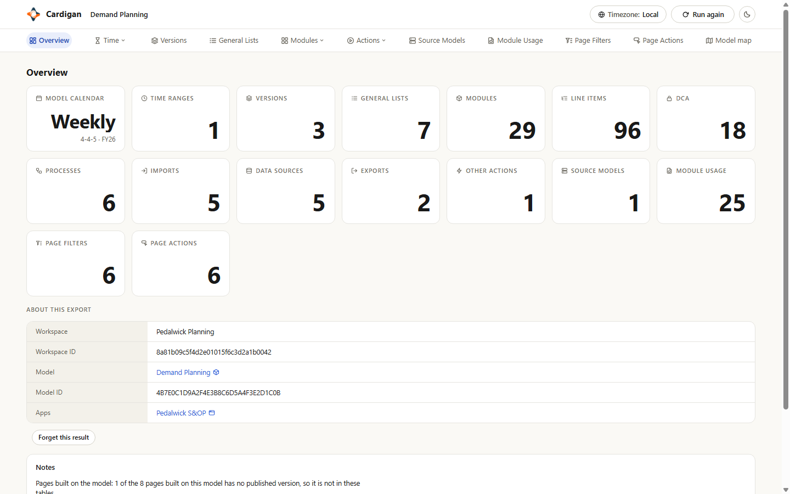
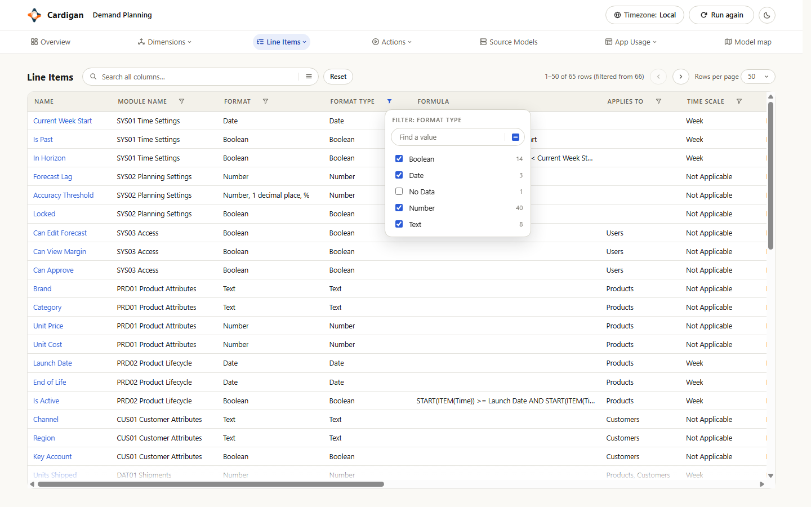
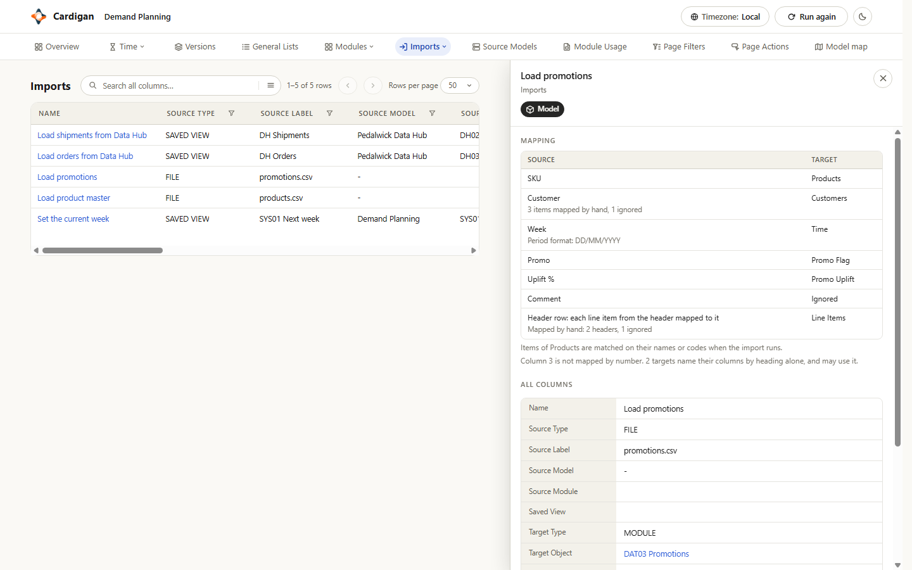
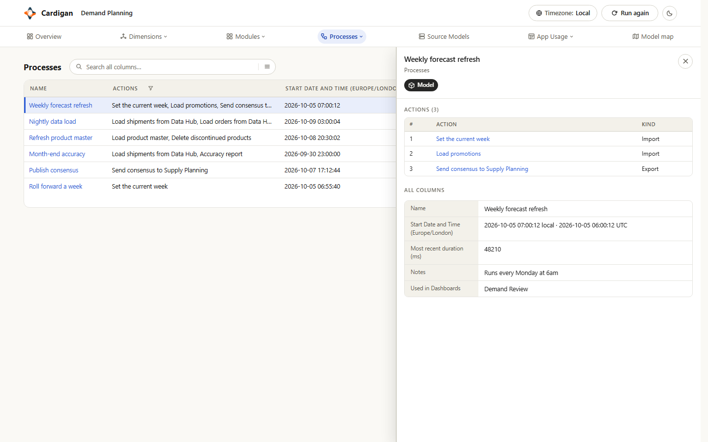
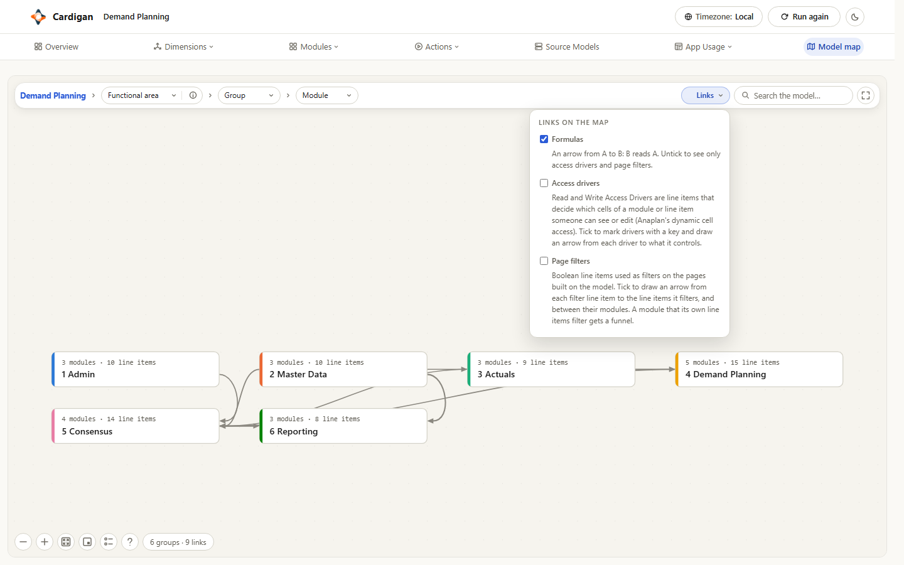
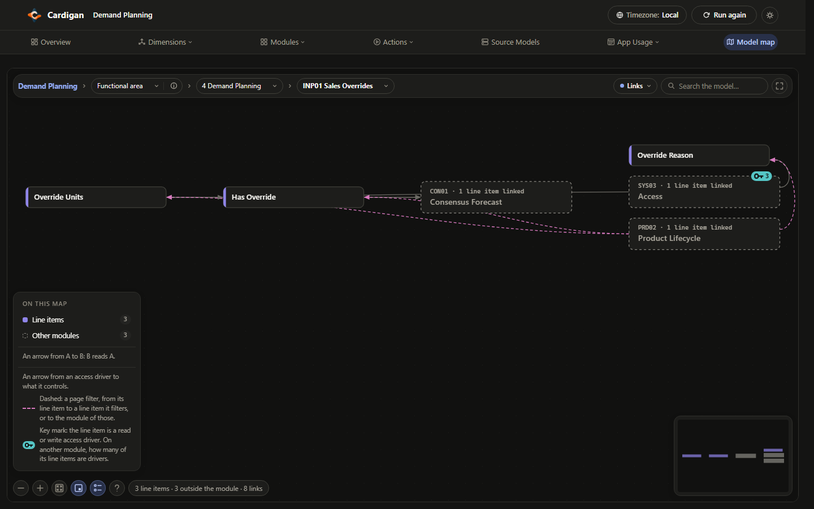
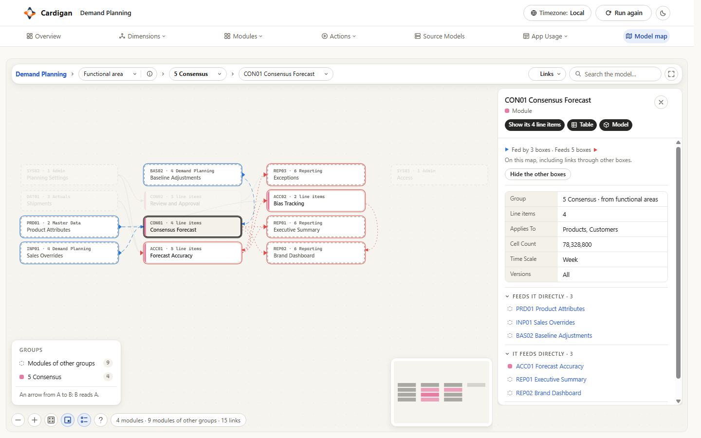

# Cardigan

Cardigan is a read-only Chrome extension that reads an Anaplan model or app you have open and lays it out as searchable tables and an Overview, with a Model map for models. It changes nothing in your model or app.

Cardigan only reads, with your own signed-in session; nothing leaves your browser except those reads to Anaplan. See [NOTICE.md](NOTICE.md).

## Contents

▪ **[What you get](#what-you-get)**\
&emsp;– [For a model](#for-a-model)\
&emsp;– [Model map](#model-map)\
&emsp;– [For an app](#for-an-app)\
▪ **[Install](#install)**\
▪ **[Use](#use)**\
&emsp;– [Run](#run)\
&emsp;– [Refresh the Anaplan tab and run](#refresh-the-anaplan-tab-and-run)\
&emsp;– [Working with tables](#working-with-tables)\
&emsp;– [If it does not start](#if-it-does-not-start)\
▪ **[Privacy and permissions](#privacy-and-permissions)**\
▪ **[Limits](#limits)**\
▪ **[For developers](#for-developers)**\
&emsp;– [Release](#release)\
▪ **[Thanks](#thanks)**\
▪ **[Licence](#licence)**

## What you get

### For a model

Open the model in **Model Building**. The **Overview** shows table counts, the model calendar, details of what was read and any gaps. Click a tile to open its table. **How to read these tables**, on the Overview, explains each table's columns and rules.

The menu bar groups the model's tables:

<table>
  <thead>
    <tr><th>Menu</th><th>Table</th><th>What it shows</th></tr>
  </thead>
  <tbody>
    <tr><td rowspan="5"><b>Dimensions</b></td><td>Model Calendar</td><td>The model's calendar settings.</td></tr>
    <tr><td>Time Ranges</td><td>The model's time ranges.</td></tr>
    <tr><td>Versions</td><td>Versions and their settings.</td></tr>
    <tr><td>General Lists</td><td>Lists, hierarchies, properties and subsets.</td></tr>
    <tr><td>Line Item Subsets</td><td>Subsets, their modules and member counts.</td></tr>
    <tr><td rowspan="3"><b>Modules</b></td><td>Modules</td><td>Modules, dimensions, functional areas and settings.</td></tr>
    <tr><td>Line Items</td><td>Line items, formulas, formats and dimensions.</td></tr>
    <tr><td>DCA (Dynamic Cell Access)</td><td>Read and write access drivers and what they control.</td></tr>
    <tr><td rowspan="5"><b>Actions</b></td><td>Processes</td><td>Processes and their actions.</td></tr>
    <tr><td>Imports</td><td>Sources, targets and import settings.</td></tr>
    <tr><td>Data Sources</td><td>Import sources and the imports that use them.</td></tr>
    <tr><td>Exports</td><td>Export actions and their settings.</td></tr>
    <tr><td>Other Actions</td><td>Other model actions, such as deleting or ordering list items.</td></tr>
    <tr><td><b>Source Models</b></td><td>Source Models</td><td>Source model mappings and their sources and imports.</td></tr>
    <tr><td rowspan="3"><b>App Usage</b></td><td>Module Usage</td><td>Where published pages use the model's modules.</td></tr>
    <tr><td>Page Filters</td><td>Card filters on pages built on the model.</td></tr>
    <tr><td>Page Actions</td><td>Action buttons on pages built on the model.</td></tr>
  </tbody>
</table>

**Line Items** lists each line item beside its module. Module settings have their own table, **Modules**. Use **Format type** to filter by data type; untick **No Data** to leave out line items used as headings. Open a row to read its formula, dimensions and references in full.

**Imports** shows where data comes from and where it goes. For file imports, the row's **Mapping** shows the saved sources and targets, including constants and prompts, and notes targets that are not mapped. It reads the saved definition, not the uploaded file. If the open page cannot name a property an import maps into, Cardigan reads that list's properties once. Properties it still cannot name keep their IDs, with a note in the diagnostic log.

**Processes** shows each process's actions in run order. Open a row to see the steps and follow an action to its own details.

**Line Item Subsets** shows member counts. Open a subset to see its members grouped by module and follow them to their rows. The details say when membership could not be read.

**Classic and Polaris:** Cardigan reads both engines the same way through Model Building, so the tables are the same. When Model Building's client does not answer, Cardigan reads what it can and the Overview explains what is missing.

### Model map

The map shows how a model's groups, modules and line items connect. It is built from the result already in your browser.

- **Group by** offers ways to organise modules: functional area, headings, name prefix, DISCO (Data, Input, System, Calculation, Output), app or main dimension. Its (i) explains how the grouping works and which fits the model best.
- Choose a **Group** or **Module** to explore it, or search for a group, module or line item.
- **Links** lets you show formula, access-driver and page-filter connections.
- Click a box for details and its connections. **Hide the other boxes** keeps its chain in view; **Show all boxes** brings the others back. **Table** and **Model** open the matching row or place in Anaplan where available.
- Zoom out, Zoom in, Fit, Minimap, Legend and About share the controls row at the bottom left. **About** explains the map and its limits.

The pictures use an invented bicycle planning model. All names, identifiers and data are invented.

### For an app

- **Pages:** page types, publish state, models and card counts.
- **Cards:** the modules, views, line items and settings used by each card.
- **Grid Sections:** the sections of grids and charts.
- **Filters:** filter conditions on card grids.
- **Conditional Formatting:** formatting rules and indicators.
- **Action Buttons:** buttons and the actions they refer to.
- **Model Objects:** where cards use modules, line items, dimensions, views, actions and linked pages.

## Install

You need Chrome 111 or later.

1. Download `cardigan-<version>.zip` from **Assets** on the [latest release](https://github.com/larasrinath/cardigan/releases/latest). Choose the extension zip, not GitHub's **Source code** archives.
2. Unzip it into a folder you will keep. It should contain `manifest.json` and a `dist` folder with five JavaScript files.
3. Open `chrome://extensions`, turn on **Developer mode**, choose **Load unpacked** and select that folder.
4. Pin Cardigan using Chrome's puzzle icon, then click it on an Anaplan tab.

To update, unzip the new release over the same folder and reload Cardigan in `chrome://extensions`. Click its icon on your Anaplan tab; follow the refresh prompt if one appears. Right-click the icon for **About Cardigan** and the installed version. See [CHANGELOG.md](CHANGELOG.md) for changes.

## Use

### Run

1. Sign in to Anaplan and open an app, or a model in Model Building. Wait for it to load.
2. Click the Cardigan icon. It opens a results tab, or uses the results tab already open for that Anaplan tab.
3. Keep the Anaplan tab open while Cardigan reads. The analysing page shows a run card with changing phrases and an elapsed timer; the current step is available in its tooltip and to screen readers.

**Run again** reads the tab again, keeping the current result visible until the new one is ready. Clicking the icon again also runs again; a read already in progress carries on. Closing the results tab stops the read. **Diagnostics** lets you inspect or copy the log.

### Refresh the Anaplan tab and run

This button appears when Cardigan cannot load or update its reader in the open Anaplan tab. Choosing it refreshes that tab to load the reader and starts the read; this closes the modules and lists open in Model Building.

### Working with tables

- **Search** finds text in shown and hidden columns; click a column name to sort.
- **Filters** open from a column's funnel. Find values, then use the checkbox beside the find box to tick or untick all matches; ticking every value clears that column's filter. Numbers and dates use **From** and **To** ranges.
- **Columns** can be shown or hidden with the chooser beside search; **Defaults** restores the starting layout.
- **Details** open when you click a row. Follow linked names to other rows and use **Back** to return; drag the panel's left edge to resize it.
- **Open in Anaplan** with the buttons under a row's name: **Model**, **App** or **Page**, where available. A line item's Model button opens its module.
- **Keys:** `/` focuses search, **Esc** closes a menu or panel, and the Up and Down arrow keys move through a menu's tables.
- **Reset** clears the current table's search, filters and sort. The header also has theme and **Timezone** controls.
- **Refresh** restores the last kept result without reading Anaplan. Searches, filters, columns, sort, page, map view and open details are kept for the tab; **Run again** on the same model or app keeps what still fits.
- **Forget this result**, on the Overview, removes the kept result and view choices. The result stays on screen until you refresh or close the tab.

### If it does not start

- If the model is still opening, wait until it is visible in Anaplan, then choose **Run again**.
- If the tab was closed or is not showing an app or model, open one and click Cardigan's icon on that tab.
- If Anaplan is down for maintenance, try again when it is back.
- If Chrome cannot load `dist/content.js`, check that you extracted the extension zip and selected the folder containing `manifest.json` and `dist`.
- For other failures, read the message and use **Copy diagnostic log** to investigate.

## Privacy and permissions

Cardigan reads only when you start a run, using your signed-in Anaplan session. It does not edit models or apps, run model actions or read module cell values. The results and About pages load only packaged files. There is no Cardigan server, analytics or telemetry, and no result download.

| Permission | Why it is used |
| --- | --- |
| `activeTab` and `scripting` | Put Cardigan's reader into the Anaplan tab you clicked, including after an install or update. |
| `contextMenus` | Add About Cardigan and the version to its toolbar icon's menu. |

Its content scripts run on `https://*.app.anaplan.com/*` and `https://*.app2.anaplan.com/*`, adding no controls to Anaplan's pages. Buttons that open things in Anaplan change the page shown, without changing the model or app.

The last result and your view choices are kept in that tab's session storage. The result is compressed, not encrypted; searches and filters can contain model names and values. **Forget this result** removes the kept copy. Closing a tab does not guarantee erasure, because Chrome may keep it for restoration. Theme, map grouping and time-zone preferences are kept separately in local storage, without model or app data.

Use Cardigan only on models and apps you are allowed to read. [NOTICE.md](NOTICE.md) gives the full privacy and storage details and [lists the reads to Anaplan](NOTICE.md#requests-to-anaplan).

## Limits

- Only published page definitions you can access are read. App Usage needs the model open through Model Building; the Overview reports pages or tables that could not be read.
- Reading page references can cause Anaplan to load the models they use.
- Saved views' own filters, sorts and hidden items are not listed. Some names may remain as IDs when they cannot be read.
- File-import mappings describe saved definitions, not every column of the uploaded file. Other import types have no Mapping panel.
- The map does not evaluate formulas or draw processes and actions. **About** explains what it could not place.
- Very large tables may not be read, and large results may not fit in session storage; the page says so. Map zoom, position, search and full screen may reset on refresh.
- Anaplan's internal services can change without notice, so results may become incomplete or stop working.

## For developers

Use Node 20.19 or later in the 20.x series, 22.12 or later in the 22.x series, or 24+.

| Command | What it does |
| --- | --- |
| `npm ci` | Install pinned dependencies. |
| `npm run build` | Type-check and build the extension into `dist/`. |
| `npm test` | Run the source tests. |
| `npm run test:scripts` | Run the build and packaging tests. |
| `npm run check` | Run the typecheck, both test suites and build; CI runs this too. |
| `npm run package` | Build and create the release zip. |
| `npm run icons` | Rebuild the icons from `icons/source.png`. |

Build, then load the repository root with **Load unpacked**. Rebuild after pulling changes and reload the extension. Readers live in `src/` and `src/model/`, the results page in `src/results/`, and the map in `src/map/`.

### Release

Follow the version rule in [CHANGELOG.md](CHANGELOG.md): features get a minor version, fixes and speed-ups a patch; docs alone keep the version. Keep release versions aligned in `manifest.json`, `package.json` and `package-lock.json`, and record extension changes in the changelog.

1. Run `npm run check`.
2. Run `npm run package` to create `release/cardigan-<version>.zip` and print its SHA-256.
3. Publish that zip with its SHA-256.

## Thanks

Thanks to [Harish Ramaiah](https://www.linkedin.com/in/harish-ramaiah-1327794/) for valuable ideas and feedback.

## Licence

Cardigan is released under the [MIT licence](LICENSE).

Cardigan is an independent project. It is not affiliated with, endorsed by or supported by Anaplan.
